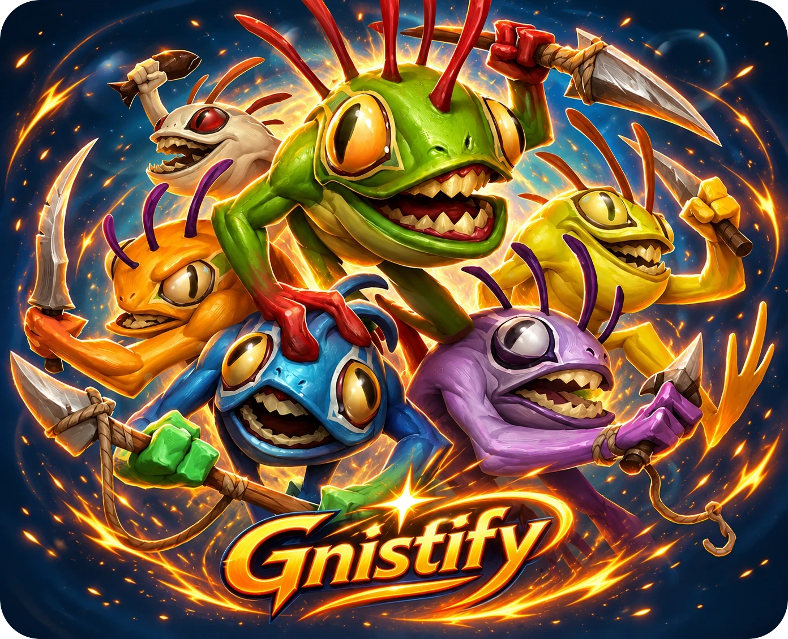

  

  <b>Addon til guilden Gnisterne på WoW Forever.</b> 
  <i>Længe leve gnisten!</i>

---

## ✨ Hvad kan den?

| Funktion | Hvad |
|---|---|
| 🎉 **Ding** | Hele guilden hører det, når nogen stiger i level |
| ⚔️ **PvP-drab** | Hvert killing blow bliver råbt ud, med hjælperne |
| 👑 **PvP-tavle** | Dagens, ugens, månedens og all-time slamberter, med titler og elite-drage |
| 💀 **Nordvestlisten** | Guildens kill on sight-liste med advarsel, når de dukker op |
| 🤺 **Dueller** | Guild-dueller med frække kommentarer og en duel-tavle |
| 🎯 **Leder i BG** | Én tast tager shot callerens mål |
| 🎣 **Fiskeri** | Sjældne fangster, skill-dings og et højere plask |
| 💜 **Episk loot** | Alle ser det, når nogen looter lilla eller orange |
| 📅 **Streaks** | Dage i træk du har logget ind |
| 🛠️ **Professioner** | Slå op, hvem der kan hvad |
| 🗺️ **Gnister i zonen** | Se, hvem fra guilden der er i samme zone |
| 🧭 **Skift sporing** | Skifter mellem herbs, minerals og humanoids |
| ⚡ **:gnist:** | Skriv `:gnist:` i chatten og vis en lille gnist |

Alt kan slås til og fra i `/gnist`. `/gnist hjælp` viser alle kommandoer.

## 📦 Installation

1. Hent nyeste version fra **Releases** eller CurseForge.
2. Pak den ud i `World of Warcraft/_forever_/Interface/AddOns/`, så mappen hedder `Gnistify`.
3. Genstart WoW.

For udviklere

Hver push til `main` bliver en ny version på GitHub Releases og CurseForge.
Lav selv et tag (fx `v1.1.0`) for et større versionsnummer. Ændringer, der kun rører
README, CLAUDE.md, `art/` eller `.github/`, giver ingen ny version, og `[skip ci]` i
commit-beskeden springer over.

